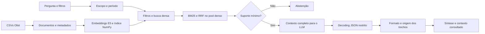

# Escuta — Voice of Customer Intelligence com RAG

Tech Challenge · Fase 4 · Inteligência Artificial e Ciência de Dados.

Repositório da entrega: [renatobortolotto/fiap-fase4](https://github.com/renatobortolotto/fiap-fase4).

Uma aplicação local para investigar comentários de compras da **Olist**. A busca
semântica e lexical seleciona relatos; o modelo produz uma síntese do contexto
completo recuperado e apresenta trechos ilustrativos cuja origem é conferida.
Esses trechos ajudam a inspecionar a resposta, mas não certificam cada afirmação.

Esta revisão técnica usa o contrato `context-synthesis-v2`. A execução final dos
testes, a aceitação ponta a ponta e a instalação limpa ainda estão em validação.
Os relatórios anteriores são preservados como histórico; não comprovam, por si,
o comportamento desta revisão. Nenhuma avaliação independente por pessoas foi
concluída nesta documentação.

Os padrões de organização das fases anteriores foram reaproveitados. As bases
educacionais das fases 2 e 3 e o modelo preditivo de NPS da fase 1 não integram
esta base de conhecimento.

## Instalação e execução no Windows

Recomendado: **Windows x64, Python 3.12 e [uv](https://docs.astral.sh/uv/getting-started/installation/)**,
**16 GB de RAM** e cerca de **10 GB livres em disco** para a instalação padrão.
O gerador padrão é **Qwen 7B GGUF quantizado em CPU**, com runtime portátil
gerenciado pela aplicação. GPU, chave de API e instalação global de um servidor
não são requisitos. Reserve espaço adicional se mantiver outros modelos em cache.

```powershell
git clone https://github.com/renatobortolotto/fiap-fase4.git
cd fiap-fase4
powershell -NoProfile -ExecutionPolicy Bypass -File scripts\Setup.ps1
```

`Setup.ps1` cria as pastas de execução, instala dependências e cria `.env` somente
se ele não existir. `.python-version` seleciona Python 3.12 e `artifacts/.gitkeep`
preserva a pasta em um clone sem índice. Uma configuração `.env` antiga é mantida:
revise modelo e provedor ao atualizar uma instalação existente.

Se você já baixou o ZIP oficial da Olist, pode instalar e preparar os dados em um
único comando. Use aspas em caminhos com espaços:

```powershell
powershell -NoProfile -ExecutionPolicy Bypass -File scripts\Setup.ps1 -ArchivePath "C:\Users\Seu Usuario\Downloads\Olist Dataset\archive.zip"
```

`-ArchivePath` implica preparação dos dados e construção do índice. Como alternativa,
`Setup.ps1 -PrepareData` tenta baixar a base oficial e executa as mesmas etapas.
Sem essas opções, a instalação das dependências não prepara os dados. Os comandos
individuais são:

```powershell
.venv\Scripts\python.exe -m voc_olist download
.venv\Scripts\python.exe -m voc_olist prepare
.venv\Scripts\python.exe -m voc_olist index
```

Depois, abra **INICIAR.cmd**, ou execute:

```powershell
.venv\Scripts\python.exe -m streamlit run app.py
```

O modelo padrão é **`Qwen/Qwen2.5-7B-Instruct-GGUF:Q4_K_M`**, revisão
`bb5d59e06d9551d752d08b292a50eb208b07ab1f`, com quatro threads de CPU. Os dois
segmentos GGUF somam aproximadamente **4,68 GB**. O runtime portátil oficial
**llama.cpp b12359** acrescenta cerca de **25 MB**, além do encoder e das dependências.
A geração em CPU e o primeiro carregamento podem demorar; memória e tempo variam
com o equipamento. O tamanho do modelo não substitui a avaliação de suas respostas.

Os arquivos são obtidos no primeiro uso. Para preparar o runtime e os modelos
antecipadamente, sem criar o índice nem iniciar uma consulta:

```powershell
.venv\Scripts\python.exe -m voc_olist models
```

Os downloads nativos usam `.cache/native`, com tamanhos e SHA-256 esperados,
retomada de transferências e versões fixadas. Não há instalação global nem
privilégio de administrador para esse runtime. Durante a geração, a aplicação
inicia seu próprio servidor llama.cpp oculto, em uma porta temporária de
`127.0.0.1`, reutiliza-o nas consultas e o encerra ao terminar o processo Python.
Fechar somente a aba do navegador não equivale a encerrar esse processo.

O helper `model_store.py` obtém o encoder e os modelos Transformers opcionais em
pastas locais com arquivos normais, sem exigir symlinks. Caches legados completos
são preservados e reutilizados. A instalação limpa desta configuração nativa
ainda precisa de sua execução final registrada.

### Alternativa opcional: Transformers

O fallback usa `Qwen/Qwen2.5-1.5B-Instruct`, revisão
`989aa7980e4cf806f80c7fef2b1adb7bc71aa306`, com download adicional de cerca de
3,1 GB. Esse caminho usa LM Format Enforcer para o JSON e deve ser avaliado
separadamente:

```powershell
.venv\Scripts\python.exe -m voc_olist ask "O que relatam sobre atrasos na entrega?" --provider transformers
```

### Alternativa opcional: Ollama

Para usar Ollama, instale o aplicativo, mantenha-o em execução e obtenha o modelo:

```powershell
ollama pull qwen2.5:3b
.venv\Scripts\python.exe -m voc_olist ask "O que relatam sobre atrasos na entrega?" --provider ollama
```

O provedor `native` usa o runtime gerenciado; `transformers` e `ollama` são
alternativas. **Somente evidências** mostra pesquisa e comentários, sem geração,
e não demonstra sozinho o pipeline RAG completo.

### Instalação sem uv

```powershell
py -3.12 -m venv .venv
.venv\Scripts\python.exe -m pip install torch --index-url https://download.pytorch.org/whl/cpu
.venv\Scripts\python.exe -m pip install -e ".[dev]"
if (-not (Test-Path .env)) { Copy-Item .env.example .env }
```

O caminho recomendado usa `uv sync --locked`. Para encoder e fallback Transformers,
o lock desta revisão fixa
**Transformers 4.57.6**, **Sentence Transformers 5.7.0** e **LM Format Enforcer
0.11.3**, combinados para o decoder desse fallback. O padrão nativo utiliza o
llama.cpp portátil fixado em b12359. O fallback pip resolve as faixas
do `pyproject.toml` e pode produzir versões diferentes; ele não usa `uv.lock`.

## Dados e preparação

Fonte: [Brazilian E-Commerce Public Dataset by Olist, no Kaggle](https://www.kaggle.com/datasets/olistbr/brazilian-ecommerce).
Licença informada na fonte: **[CC BY-NC-SA 4.0](https://creativecommons.org/licenses/by-nc-sa/4.0/)**.
A atribuição dos trechos reais incluídos está em [DATA_NOTICE.md](DATA_NOTICE.md).

| CSV | Papel |
| --- | --- |
| `olist_order_reviews_dataset.csv` | Título, mensagem, nota e identificadores das avaliações |
| `olist_orders_dataset.csv` | Data da compra e datas de entrega |
| `olist_order_items_dataset.csv` | Associação de pedidos a produtos |
| `olist_products_dataset.csv` | Categorias dos produtos |

O download registra hashes SHA-256. Para importar um ZIP já obtido, sem repetir a
instalação, execute:

```powershell
.venv\Scripts\python.exe -m voc_olist download --archive "C:\Dados Olist\archive.zip"
.venv\Scripts\python.exe -m voc_olist prepare
.venv\Scripts\python.exe -m voc_olist index
```

`prepare` também aceita somente o CSV de avaliações, mantendo os metadados ausentes
como desconhecidos. Sua política:

- Um documento por par `review_id + order_id`, com `doc_id` SHA-256 estável.
- União de título e comentário, limpeza de espaços e entidades HTML, preservando
  acentos, negação e conteúdo do cliente.
- Exclusão de registros sem texto, sem inventar comentários para valores ausentes.
- Validação de IDs e notas, registro de descartes, duplicatas e conflitos.
- Agregação de categorias antes dos joins, sem multiplicar avaliações por item.
- Comparação da entrega com a estimativa no nível de dia; datas ausentes mantêm
  `delivered_late` desconhecido.
- Geração de `documents.jsonl` e `preparation_report.json`, com contagens e hashes.

Na base preparada: **99.224 avaliações → 42.687 documentos**, com 56.537 registros
sem texto excluídos e 1.737 documentos apenas com título. A indexação codifica os
**37.111 textos distintos**, ordenados por comprimento para os lotes, e restaura a
associação de cada vetor aos 42.687 documentos. Essa economia não remove avaliações
de pedidos distintos. A seleção do contexto evita textos repetidos na mesma resposta.

O corpus textual tem composição de notas diferente da base completa; não representa
a satisfação de todos os pedidos.

## Arquitetura



**Recuperação:** `intfloat/multilingual-e5-small`, 384 dimensões, prefixos `query:`
e `passage:`, revisão fixada e vetores normalizados. A busca NumPy calcula cosseno.
O modo `hybrid` combina ranks denso e BM25 por RRF de pesos iguais e constante 60,
dentro dos candidatos densos elegíveis. BM25 usa estatísticas do corpus, mas não
recupera fora desse pool. Filtros, deduplicação textual e limiar de cosseno precedem
a reordenação. `dense` mantém a linha de base disponível.

**Escopo:** `ScopeGuard` diferencia investigação de relatos de tarefas externas,
comparando a pergunta com famílias de tarefas via E5 e margem inicial 0,015. Soma
regras para agregações não implementadas e períodos sem dados. É uma heurística,
não uma probabilidade ou uma certificação de que a pergunta é respondível. O índice
híbrido e os protótipos do guard são mantidos em cache na sessão, sem repetir sua
construção a cada pergunta.

**Período:** um ano temporal explícito, como “entregas em 2017”, torna-se filtro
de compra de `2017-01-01` a `2017-12-31`. O filtro efetivo aparece na interface e
na exportação, intersectado com o período manual. Nota, categoria e situação de
atraso continuam sendo filtros explícitos do usuário. Um código de produto não
deve ser confundido automaticamente com ano.

**Geração:** o padrão Qwen 7B Q4_K_M usa llama.cpp portátil, com schema JSON enviado
ao servidor local gerenciado. O fallback Transformers 1,5B usa LM Format Enforcer.
As restrições controlam formato e escolhas permitidas,
**não a verdade nem o suporte semântico**. A aplicação ainda valida a resposta,
pode pedir uma correção e se abstém quando o resultado não passa nos controles.

## Contrato de resposta e interface

O contrato **`context-synthesis-v2`** separa síntese e exemplos:

| Campo | Significado |
| --- | --- |
| `findings` | Uma ou duas sínteses do contexto recuperado completo, sem IDs individuais anexados a cada frase |
| `context_evidence_ids` | Rótulos de todas as fontes do contexto, fornecidos pelo sistema; até E1–E8 no padrão |
| `illustrative_quotes` | Um ou dois trechos literais com `evidence_id`, conferidos na fonte indicada |
| `sources` | Contexto enviado, `doc_id`, `review_id`, `order_id`, nota, período, categorias e similaridade |
| `literal_quotes_verified` | Conferência de origem textual dos exemplos; não verifica a síntese |
| `summary_entailment_verified` | `false`: não há certificação automática de sustentação semântica |

O gerador recebe todas as fontes em `context_evidence_ids`, com seus trechos e
metadados. **Contexto consultado** mostra esse conjunto global. **Trechos
ilustrativos** apresenta exemplos cuja correspondência literal foi conferida por
comparação normalizada. Um exemplo não é anunciado como prova de todas as frases
da síntese. O revisor deve confrontar cada síntese com o contexto completo.

Se o modelo escolher uma fonte errada para um trecho, a resposta é rejeitada; o
contrato atual não transfere silenciosamente a citação para outra fonte. Os rótulos
E1/E2 são locais à resposta e mapeiam aos `doc_id` persistentes na exportação JSON.
O histórico permanece apenas na sessão. Comentários são tratados como dados.

## Consultas

```powershell
.venv\Scripts\python.exe -m voc_olist ask "O que relatam sobre atrasos na entrega?" --score-max 2 --output reports\minha-consulta.json
.venv\Scripts\python.exe -m voc_olist ask "O que relatam sobre a entrega em 2017?"
.venv\Scripts\python.exe -m voc_olist ask "Há relatos de problemas com a entrega?" --category beleza_saude --late yes --provider evidence
.venv\Scripts\python.exe -m voc_olist ask "Quantos clientes reclamaram de atraso em toda a base?"
```

A última pergunta pede uma agregação global que este RAG não calcula. A aplicação
deve comunicar o limite e oferecer investigação qualitativa. Perguntas externas,
períodos sem dados e temas sem evidências também podem resultar em abstenção.
Os exemplos acima são consultas para execução, não respostas inventadas. Os JSONs
de novas execuções devem ser identificados pelo contrato e configuração; relatórios
históricos de modelos e contratos anteriores permanecem separados.

## Configuração

`Setup.ps1` preserva `.env`. Valores propostos em `.env.example`:

| Variável | Padrão |
| --- | --- |
| `LLM_PROVIDER` | `native` |
| `LLM_MODEL` | `Qwen/Qwen2.5-7B-Instruct-GGUF:Q4_K_M` |
| `LLM_REVISION` | `bb5d59e06d9551d752d08b292a50eb208b07ab1f` |
| `LLM_THREADS` | `4` |
| `LLM_TIMEOUT` | `180` segundos |
| `OLLAMA_BASE_URL` | `http://127.0.0.1:11434`, para o provedor opcional |
| `EMBEDDING_MODEL` | `intfloat/multilingual-e5-small` |
| `EMBEDDING_REVISION` | `614241f622f53c4eeff9890bdc4f31cfecc418b3` |
| `MIN_SIMILARITY` | `0.75`, limiar inicial sujeito a calibração |
| `MIN_EVIDENCES` | `2` comentários distintos |
| `TOP_K` | `8` fontes de contexto |
| `RETRIEVAL_MODE` | `hybrid`, ou `dense` para comparação |

O contexto tem teto de 9.000 caracteres, até 1.000 por trecho, e limite de tokens no
gerador local. O manifesto valida arquivos, dimensões e identidade do encoder.
Hashes comprovam integridade dos artefatos, não veracidade dos relatos.

**Top-k não mede prevalência:** a seleção por relevância não permite calcular o tema
mais frequente, porcentagens ou rankings populacionais. As contagens da interface
são calculadas separadamente no corpus textual e não são contagens de temas.

## Testes e avaliação

```powershell
.venv\Scripts\python.exe -m pytest -q --basetemp artifacts\pytest-local
.venv\Scripts\python.exe -m voc_olist index --documents evaluation\pool_documents.jsonl --index-dir artifacts\evaluation-index
.venv\Scripts\python.exe -m voc_olist evaluate --queries evaluation\questions.jsonl --index-dir artifacts\evaluation-index --top-k 4 --output reports\review-20261116\retrieval-hybrid.json
```

O pool incluído tem 17 documentos reais, quatro perguntas de relevância e um caso
com período vazio. Seus rótulos foram propostos com auxílio de IA e precisam de
revisão humana. Recall@k e MRR@k usam apenas perguntas com `relevant_ids` não vazios;
sem rótulos, ficam nulos. `expect_abstain` mede somente o gate de recuperação com
menos de dois hits, não o guard nem a geração.

A revisão prevê ensaio de aceitação com 24 casos e inspeção assistida por IA,
seguida de leitura pelo revisor. **A execução e os números finais ainda estão
pendentes.** Esse ensaio não será apresentado como julgamento humano já concluído,
teste cego ou benchmark independente. Sustentação deve ser avaliada contra todo o
contexto, até oito fontes no padrão, não só contra os exemplos escolhidos.

As fixtures de testes são controladas e não entram no corpus oficial. Os
[detalhes de avaliação](docs/avaliacao.md) separam integridade, formato, origem
literal, suporte semântico e comportamento de recusa.

## Organização e entrega

```text
app.py                  interface Streamlit
src/voc_olist/          dados, índice, guard, modelos, geração, RAG, CLI e avaliação
.cache/native/          modelo GGUF e runtime portátil verificados (fora do Git)
tests/                  testes com fixtures controladas
data/raw/               CSVs oficiais (fora do Git)
data/processed/         documentos e relatório (fora do Git)
artifacts/index/        índice e manifesto (fora do Git)
evaluation/             perguntas e rótulos de desenvolvimento
reports/                execuções e histórico, identificados por configuração
docs/                   arquitetura, decisões, avaliação e roteiro
scripts/                instalação e execução no Windows
uv.lock                 dependências fixadas
```

Leia [arquitetura](docs/arquitetura.md), [decisões técnicas](docs/decisoes-tecnicas.md),
[avaliação](docs/avaliacao.md), [roteiro de até 7 minutos](docs/roteiro-video.md) e
[checklist](docs/checklist-entrega.md). O link público da entrega e seu estado estão
em [docs/entrega.md](docs/entrega.md); uma revisão local não implica publicação de
suas alterações. A equipe ainda deve revisar o material e gravar o vídeo. A trilha
Databricks mencionada no enunciado é opcional.

## Referências técnicas

- [Dataset Olist](https://www.kaggle.com/datasets/olistbr/brazilian-ecommerce)
- [Multilingual E5](https://huggingface.co/intfloat/multilingual-e5-small)
- [Qwen2.5-1.5B-Instruct](https://huggingface.co/Qwen/Qwen2.5-1.5B-Instruct)
- [Qwen2.5-7B-Instruct-GGUF](https://huggingface.co/Qwen/Qwen2.5-7B-Instruct-GGUF)
- [Runtime llama.cpp b12359](https://github.com/ggml-org/llama.cpp/releases/tag/b12359)
- [LM Format Enforcer](https://github.com/noamgat/lm-format-enforcer)
- [Ollama: chat](https://docs.ollama.com/api/chat)
- [Streamlit: chat](https://docs.streamlit.io/develop/api-reference/chat/st.chat_input)
