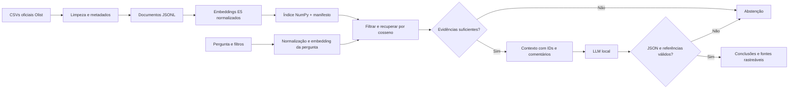

# Escuta — Voice of Customer Intelligence com RAG

Tech Challenge · Fase 4 · Inteligência Artificial e Ciência de Dados.

Repositório: [renatobortolotto/fiap-fase4](https://github.com/renatobortolotto/fiap-fase4).

Uma aplicação local para investigar avaliações de compras da **Olist**. A pergunta
é transformada em um embedding; a busca recupera comentários relevantes; um modelo
de linguagem produz conclusões em português com referências às avaliações usadas.
Quando não há suporte suficiente ou uma referência é inválida, a aplicação se abstém.

O projeto parte dos padrões de organização e documentação das fases anteriores.
As bases educacionais das fases 2 e 3 e o modelo preditivo de NPS da fase 1 não são
usados como fontes: este desafio exige as avaliações textuais da Olist.

## Execução rápida no Windows

Se esta pasta já foi preparada neste computador, abra **INICIAR.cmd**. A configuração
local usa o modelo pequeno com Transformers; o `.env.example` oferece Ollama como
alternativa. Os passos abaixo permitem instalar novamente ou reproduzir em outra máquina.

Recomendado: **Python 3.12 e [uv](https://docs.astral.sh/uv/getting-started/installation/)**.
Não é necessário GCP, BigQuery, GPU nem chave de API.

```powershell
git clone https://github.com/renatobortolotto/fiap-fase4.git
cd fiap-fase4
powershell -NoProfile -ExecutionPolicy Bypass -File scripts\Setup.ps1
```

Caso ainda não existam dados e índice:

```powershell
.venv\Scripts\python.exe -m voc_olist download
.venv\Scripts\python.exe -m voc_olist prepare
.venv\Scripts\python.exe -m voc_olist index
```

Para a geração recomendada, instale [Ollama](https://ollama.com/download), mantenha
o aplicativo em execução e baixe o modelo:

```powershell
ollama pull qwen2.5:3b
```

Depois abra `INICIAR.cmd`, ou execute:

```powershell
.venv\Scripts\python.exe -m streamlit run app.py
```

A interface oferece busca, filtros e download da resposta com as fontes em JSON.
O histórico fica apenas na sessão da aplicação. Os comentários são exibidos como
texto; não há execução de instruções contidas nas avaliações.

### Sem Ollama

A interface também oferece **RAG com modelo pequeno local**. Essa opção usa
`Qwen/Qwen2.5-0.5B-Instruct`, baixa cerca de 1 GB na primeira execução e usa CPU.
Sua qualidade é limitada e não deve ser confundida com uma validação da solução.

```powershell
.venv\Scripts\python.exe -m voc_olist ask "O que relatam sobre atrasos na entrega?" --provider transformers --output reports\minha-consulta.json
```

Para explorar apenas os comentários, sem geração:

```powershell
.venv\Scripts\python.exe -m voc_olist ask "O que relatam sobre a entrega?" --provider evidence
```

**Somente evidências** é um modo de busca e diagnóstico; não demonstra sozinho o
pipeline RAG completo exigido pelo desafio.

### Instalação sem uv

```powershell
py -3.12 -m venv .venv
.venv\Scripts\python.exe -m pip install torch --index-url https://download.pytorch.org/whl/cpu
.venv\Scripts\python.exe -m pip install -e ".[dev]"
Copy-Item .env.example .env
```

A instalação com uv usa as versões fixadas em `uv.lock`. A alternativa pip resolve
as faixas de versões do `pyproject.toml` e pode produzir versões diferentes.

## Dados e preparação

Fonte: [Brazilian E-Commerce Public Dataset by Olist, no Kaggle](https://www.kaggle.com/datasets/olistbr/brazilian-ecommerce).
Licença informada pelo Kaggle: **[CC BY-NC-SA 4.0](https://creativecommons.org/licenses/by-nc-sa/4.0/)**.
A atribuição dos trechos reais incluídos no projeto está em [DATA_NOTICE.md](DATA_NOTICE.md). Consulte os termos da fonte antes
de redistribuir ou usar comercialmente os dados. O código baixa quatro CSVs oficiais:

| CSV | Papel |
| --- | --- |
| `olist_order_reviews_dataset.csv` | Título, mensagem, nota e identificadores das avaliações |
| `olist_orders_dataset.csv` | Data da compra e datas de entrega |
| `olist_order_items_dataset.csv` | Associação de pedidos a produtos |
| `olist_products_dataset.csv` | Categorias dos produtos |

O download registra SHA-256 dos arquivos. Se o endpoint público do Kaggle estiver
indisponível, baixe o ZIP pela página oficial e execute:

```powershell
.venv\Scripts\python.exe -m voc_olist download --archive C:\caminho\archive.zip
```

`prepare` aceita somente o CSV de avaliações, com metadados desconhecidos quando
os outros arquivos não estão presentes. A preparação:

- Usa um documento por par **review_id + order_id**, com `doc_id` estável.
- Combina título e comentário; normaliza espaços e entidades HTML, preservando o
  conteúdo textual, os acentos e a negação. Não cria comentários para valores ausentes.
- Exclui registros sem título nem mensagem; preserva textos curtos e apenas título.
- Valida IDs e notas; registra descartes, duplicatas, conflitos e política de seleção.
- Agrega categorias antes de associar itens, evitando multiplicação de avaliações.
- Compara datas de entrega no nível de dia. Entrega ou previsão ausente significa
  atraso desconhecido, e não entrega no prazo.
- Produz `documents.jsonl` e `preparation_report.json`, com contagens e hashes.

Na base obtida durante a implementação: **99.224 avaliações → 42.687 documentos**,
com 56.537 registros sem texto excluídos e 1.737 documentos apenas com título.
O corpus textual tem uma composição de notas diferente da base completa; não é
uma amostra representativa da satisfação de todos os pedidos.

## Arquitetura



**Embeddings:** `intfloat/multilingual-e5-small`, 384 dimensões, com os prefixos
`query:` e `passage:`, em CPU. A revisão do modelo está fixada na configuração.
Os documentos são curtos; não é necessário dividir cada avaliação em pedaços.

**Busca:** produto escalar entre vetores normalizados, equivalente ao cosseno,
sobre matriz NumPy persistida. Para este volume, a busca exata evita um serviço
externo. O modo padrão combina esse ranking com BM25 lexical por Reciprocal Rank
Fusion, dentro de até 200 candidatos semânticos. O modo `dense` permite comparar
a linha de base. Filtros e limiar de cosseno são aplicados **antes** do reranking.
Comentários de texto idêntico não ocupam várias posições do contexto.

**Rastreabilidade:** manifesto com hashes dos documentos e vetores; verificação
de integridade, dimensão e identidade do modelo ao abrir/consultar o índice.
O contexto enviado ao LLM corresponde aos trechos exibidos ao usuário. As fontes
mantêm IDs de avaliação e pedido, nota, data, categorias e similaridade.

**Geração:** Ollama ou Transformers local. O modelo retorna conclusões em JSON,
cada uma com `evidence_ids` (E1, E2 etc., mapeados aos IDs originais nas fontes).
IDs inexistentes ou ausentes invalidam a resposta.
Essa validação garante a referência ao contexto, mas **não prova que toda
interpretação gerada está correta**: coerência e suporte semântico exigem avaliação.

Trechos copiados literalmente são conferidos contra o contexto, identificados como
citações de clientes e associados às fontes em que o texto foi encontrado. Se o
modelo copiar uma fonte e trocar seu rótulo, a correspondência literal realinha a
citação e preserva `original_evidence_ids` para auditoria. Esse controle não valida
paráfrases nem transforma opiniões do cliente em fatos confirmados.

## Consultas e exemplos

```powershell
.venv\Scripts\python.exe -m voc_olist ask "O que os clientes relatam sobre atrasos na entrega?" --score-max 2 --provider transformers
.venv\Scripts\python.exe -m voc_olist ask "O que os clientes elogiam na qualidade dos produtos?" --score-min 4 --provider transformers
.venv\Scripts\python.exe -m voc_olist ask "Há relatos de problemas com a entrega?" --category beleza_saude --late yes --provider evidence
.venv\Scripts\python.exe -m voc_olist ask "Qual será o faturamento da empresa em 2027?"
```

São perguntas de demonstração, não respostas previamente inventadas. Consulte os
JSONs em `reports/examples/` quando disponíveis para ver saídas efetivamente obtidas,
com modelo, filtros, fontes e duração. O relatório de verificação registra o que foi
executado e as limitações observadas.

Perguntas sobre causas exatas, dados futuros ou informações ausentes podem não ter
resposta. O sistema combina detector de alguns casos explícitos fora do escopo,
limiar de similaridade, mínimo de documentos distintos, abstenção do LLM e validação
do formato/fontes. Esses controles não garantem detectar toda pergunta inadequada.

## Configuração e limites

Copie `.env.example` para `.env` e ajuste quando necessário. Principais variáveis:

| Variável | Padrão | Função |
| --- | --- | --- |
| `LLM_PROVIDER` | `ollama` | `ollama`, `transformers` ou `evidence` |
| `LLM_MODEL` | `qwen2.5:3b` | Modelo gerador do provedor selecionado |
| `LLM_REVISION` | vazio | Revisão Hugging Face do gerador, quando aplicável |
| `OLLAMA_BASE_URL` | `http://127.0.0.1:11434` | Servidor Ollama |
| `EMBEDDING_MODEL` | `intfloat/multilingual-e5-small` | Modelo de recuperação |
| `EMBEDDING_REVISION` | commit fixado | Alterações exigem recriar o índice |
| `MIN_SIMILARITY` | `0.75` | Limiar inicial, ainda sujeito a calibração |
| `MIN_EVIDENCES` | `2` | Mínimo de comentários distintos para geração |
| `TOP_K` | `8` | Máximo de comentários no contexto |
| `RETRIEVAL_MODE` | `hybrid` | Reranking semântico + lexical; `dense` para a linha de base |

O contexto tem teto de 9.000 caracteres e cada trecho tem até 1.000 caracteres.
As avaliações oficiais desta versão cabem nesses limites.

**Não concluir prevalência com top-k:** os exemplos recuperados não permitem
afirmar que um tema é o problema mais frequente em toda a Olist. O sistema comunica
esse limite. Contagens exibidas na interface são calculadas separadamente sobre
todo o corpus textual e não representam uma contagem de temas.

## Testes e avaliação

```powershell
.venv\Scripts\python.exe -m pytest -q --basetemp artifacts\pytest-local
.venv\Scripts\python.exe -m voc_olist index --documents evaluation\pool_documents.jsonl --index-dir artifacts\evaluation-index
.venv\Scripts\python.exe -m voc_olist evaluate --queries evaluation\questions.jsonl --index-dir artifacts\evaluation-index --top-k 4 --output reports\evaluation-pool.json
.venv\Scripts\python.exe -m voc_olist evaluate --queries evaluation\questions.jsonl --index-dir artifacts\evaluation-index --top-k 4 --retrieval-mode dense --output reports\evaluation-dense.json
```

O arquivo de perguntas usa uma linha JSON por consulta:

```json
{"query_id":"entrega-01","question":"Há relatos de atraso?","relevant_ids":["doc_id_real"],"filters":{"score_max":2}}
```

Use IDs reais do índice e julgamentos de relevância documentados. Sem rótulos,
Recall@k e MRR@k ficam nulos. `expect_abstain` opcional avalia somente o gate de
recuperação (menos de dois resultados), não a resposta completa do modelo.
O conjunto fornecido em `evaluation/questions.jsonl` avalia somente o pool de
17 documentos reais descrito em `evaluation/README.md`. Os rótulos foram propostos
com auxílio de IA e precisam de revisão humana. O conjunto deve ser ampliado e
separado entre calibração e teste antes de alegar qualidade generalizável.

Os testes automatizados usam fixtures sintéticas explícitas para verificar
preparação, joins, filtros, persistência, corrupção, fontes inválidas e abstenção.
Nenhum texto sintético é incluído na base de conhecimento oficial.

## Organização

```text
app.py                  interface Streamlit
src/voc_olist/          preparação, recuperação, geração, RAG, CLI e avaliação
tests/                  testes automatizados com fixtures controladas
data/raw/               CSVs oficiais (fora do Git)
data/processed/         documentos e relatório de preparação (fora do Git)
artifacts/index/        índice, documentos e manifesto (fora do Git)
evaluation/             perguntas de demonstração e julgamentos documentados
reports/                resultados e exemplos realmente executados
docs/                   arquitetura, decisões, avaliação e roteiro do vídeo
scripts/                instalação e execução no Windows
uv.lock                 versões fixadas das dependências
```

Documentação: [arquitetura](docs/arquitetura.md), [decisões técnicas](docs/decisoes-tecnicas.md),
[avaliação](docs/avaliacao.md), [roteiro de até 7 minutos](docs/roteiro-video.md)
e [checklist de entrega](docs/checklist-entrega.md).

## Entrega acadêmica

O código está publicado no [repositório público da entrega](https://github.com/renatobortolotto/fiap-fase4).
Para concluir a entrega da disciplina, a equipe deve revisar o material e gravar/publicar
o vídeo de até 7 minutos com demonstração real. O roteiro está preparado; a gravação
não é gerada pela aplicação. Consulte os [links e o estado da entrega](docs/entrega.md).
A trilha Databricks mencionada no enunciado é opcional.

## Referências técnicas

- [Dataset oficial Olist](https://www.kaggle.com/datasets/olistbr/brazilian-ecommerce)
- [Modelo e instruções do multilingual E5](https://huggingface.co/intfloat/multilingual-e5-small)
- [Sentence Transformers: embeddings](https://sbert.net/examples/sentence_transformer/applications/computing-embeddings/README.html)
- [Ollama: chat e saídas estruturadas](https://docs.ollama.com/api/chat)
- [Qwen2.5-0.5B-Instruct](https://huggingface.co/Qwen/Qwen2.5-0.5B-Instruct)
- [Streamlit: interface de chat](https://docs.streamlit.io/develop/api-reference/chat/st.chat_input)
