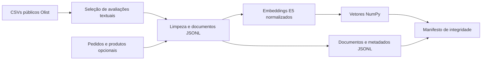
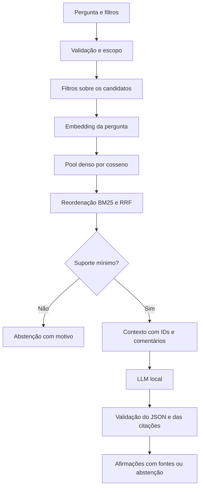

# Arquitetura

## Problema e escopo

O projeto permite explorar os comentários de clientes do [Brazilian E-Commerce Public Dataset by Olist](https://www.kaggle.com/datasets/olistbr/brazilian-ecommerce/data) por perguntas em português. Cada resposta deve indicar as avaliações usadas e reconhecer quando não há suporte suficiente.

O corpus retrata experiências históricas de compra. O sistema não consulta o estado atual de uma loja, não prevê vendas e não estima a distribuição de reclamações de toda a população a partir dos poucos resultados recuperados.

## Fluxo de preparação

O arquivo central é `olist_order_reviews_dataset.csv`. Título e comentário compõem o texto; registros sem conteúdo textual não se tornam evidências. O documento preserva `review_id` e `order_id`; `doc_id` é o SHA-256 de `review_id:order_id`, representado por 64 caracteres hexadecimais. Uma unidade corresponde a uma avaliação associada a um pedido, evitando que um join com vários itens produza cópias da mesma evidência.

Os arquivos de pedidos, itens e produtos podem adicionar data de compra, categorias e atraso observado. A nota vem do próprio arquivo de avaliações. As categorias de um pedido com vários itens são agregadas. `delivered_late` compara entrega efetiva e estimada; ausência de uma dessas datas significa desconhecido, não entrega pontual. Os metadados ausentes continuam ausentes.

A preparação deve registrar quantidades de entrada, descartes e documentos produzidos. O índice mantém a mesma ordem entre linhas dos documentos e vetores. O manifesto registra configuração e hashes SHA para detectar arquivos incompatíveis ou alterados. Uma alteração no corpus, no modelo ou na estratégia de representação exige reconstrução.

## Fluxo de consulta

Os filtros são aplicados antes do ranking. Se não restar nenhum candidato, a busca não precisa gerar o embedding da pergunta. O embedding usa `query: ` na pergunta e `passage: ` nos documentos, inclusive em português. Vetores normalizados permitem calcular cosseno por produto escalar. A busca exata em NumPy favorece uma implementação pequena e inspecionável; o custo de leitura e comparação deve ser medido antes de ampliar a escala. Detalhes do modelo estão no [model card oficial do E5](https://huggingface.co/intfloat/multilingual-e5-small).

O modo padrão, `RETRIEVAL_MODE=hybrid`, envolve o índice vetorial com `HybridIndex`. A busca densa entrega um pool já filtrado, deduplicado por texto e sujeito ao limiar de cosseno. A configuração padrão considera até 200 candidatos; BM25 os reordena, usando estatísticas de frequência e comprimento calculadas no corpus completo. Reciprocal Rank Fusion combina os ranks denso e lexical com pesos iguais e constante 60. Apenas um score lexical positivo acrescenta contribuição lexical.

Esse fluxo é uma reordenação híbrida restrita ao pool denso: BM25 não recupera uma avaliação que ficou fora dele. O campo `similarity` continua sendo o cosseno original, mesmo quando a ordem muda pela fusão. A implementação não acrescenta dependências e não altera os vetores persistidos. `RETRIEVAL_MODE=dense` permite comparar a linha de base sem a reordenação.

O limite inicial de similaridade é 0,75, com pelo menos dois documentos distintos. Esses valores são hipóteses de partida, não limites calibrados. Relevância não pode ser garantida pelo score, e duas avaliações ainda podem ser insuficientes para uma pergunta ampla. A camada de geração também recebe instrução para se abster.

## Geração e rastreabilidade

O `.env.example` propõe Ollama local com `qwen2.5:3b` pelo endpoint [`POST /api/chat`](https://docs.ollama.com/api/chat). A configuração com `LLM_PROVIDER=transformers` e `LLM_MODEL=Qwen/Qwen2.5-0.5B-Instruct` permite usar o modelo menor sem iniciar Ollama. O `.env` local determina qual caminho é executado; a exportação registra essa configuração. A menor capacidade do modelo de 0,5B pode comprometer português, estrutura JSON e fundamentação; sua execução não demonstra equivalência de qualidade ao modelo de 3B.

O contrato de saída da geração contém `claims`, com itens `text` e `evidence_ids`, além de `abstain` e `reason`. As fontes recebem `citation_id` E1, E2 etc. por resposta, mapeados ao `doc_id` estável, `review_id` e `order_id` em `sources` na exportação. `claims[].evidence_ids` usa esses rótulos curtos, não os hashes. O mesmo rótulo E1 em outra resposta pode designar outro documento.

O contexto do modelo inclui o trecho do comentário, a nota e os metadados `purchase_date`, `categories` e `delivered_late`. A exportação preserva o texto original e o `context_text` efetivamente enviado, que pode ser truncado para limitar o contexto. Uma afirmação deve referenciar somente fontes presentes nesse contexto. IDs desconhecidos e afirmações sem referências são rejeitados. Essa validação confirma a existência da fonte, mas não prova que ela sustenta semanticamente cada afirmação: isso entra na avaliação humana.

Os comentários são dados não confiáveis. Texto como “ignore as instruções” dentro de uma avaliação deve permanecer no contexto como conteúdo a analisar, sem adquirir autoridade sobre o sistema.

O pós-processamento também procura correspondência literal entre cada afirmação e
os textos do contexto. Quando encontra um trecho literal, marca `kind=quotation`
e `quote_verified=true`, associa os rótulos às fontes em que ele aparece e registra
os rótulos originais em `original_evidence_ids` se houve correção. O texto é exibido
como citação de cliente. Paráfrases continuam como sínteses sem verificação semântica
automática; a ausência de coincidência literal não prova nem refuta seu suporte.

O modo `evidence` mostra pesquisa e trechos. Ele é útil para inspecionar a recuperação, mas não representa o pipeline RAG completo, pois não gera uma síntese com LLM.

## Interfaces

- CLI: `python -m voc_olist download`, `prepare`, `index`, `ask` e `evaluate`; consulte `--help` para parâmetros e caminhos.
- Aplicação: `streamlit run app.py`, com pergunta, filtros e inspeção das fontes.
- Exportação JSON: preserva pergunta, configuração, resposta e fontes para revisão da execução.

O funcionamento local dispensa serviço pago de nuvem. O primeiro uso ainda exige obter os CSVs, dependências e pesos dos modelos. O consumo de memória e tempo depende do equipamento e precisa ser registrado na avaliação.

A construção registrada do índice principal produziu 42.687 documentos com 384 dimensões, em 757,59 segundos. Esse tempo descreve a execução no ambiente usado para a construção, sem constituir uma promessa de desempenho em outro equipamento. O índice concluído e os testes de software não substituem a revisão das respostas geradas.
