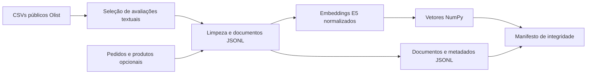
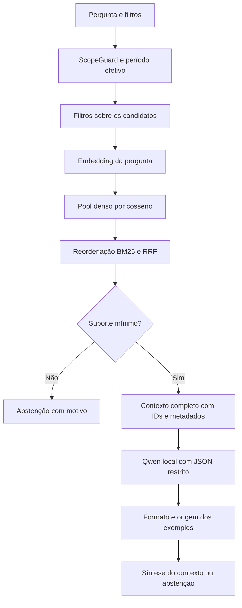

# Arquitetura

## Problema e escopo

O projeto permite explorar os comentários de clientes do [Brazilian E-Commerce Public Dataset by Olist](https://www.kaggle.com/datasets/olistbr/brazilian-ecommerce/data) por perguntas em português. A resposta sintetiza o contexto recuperado completo e oferece exemplos textuais com origem conferida. A origem de um exemplo não certifica semanticamente a síntese.

O corpus retrata experiências históricas de compra. O sistema não consulta o estado atual de uma loja, não prevê vendas e não estima a distribuição de reclamações de toda a população a partir dos poucos resultados recuperados.

## Fluxo de preparação

O arquivo central é `olist_order_reviews_dataset.csv`. Título e comentário compõem o texto; registros sem conteúdo textual não se tornam evidências. O documento preserva `review_id` e `order_id`; `doc_id` é o SHA-256 de `review_id:order_id`, representado por 64 caracteres hexadecimais. Uma unidade corresponde a uma avaliação associada a um pedido, evitando que um join com vários itens produza cópias da mesma evidência.

Os arquivos de pedidos, itens e produtos podem adicionar data de compra, categorias e atraso observado. A nota vem do próprio arquivo de avaliações. As categorias de um pedido com vários itens são agregadas. `delivered_late` compara entrega efetiva e estimada; ausência de uma dessas datas significa desconhecido, não entrega pontual. Os metadados ausentes continuam ausentes.

A preparação deve registrar quantidades de entrada, descartes e documentos produzidos. O índice mantém a mesma ordem entre linhas dos documentos e vetores. O manifesto registra configuração e hashes SHA para detectar arquivos incompatíveis ou alterados. Uma alteração no corpus, no modelo ou na estratégia de representação exige reconstrução.

Na base preparada há 42.687 documentos e 37.111 textos distintos. A indexação codifica cada texto distinto uma vez, ordenando os lotes por comprimento, e restaura os vetores para a ordem e os IDs dos documentos. Não há remoção de avaliações de pedidos distintos para economizar embeddings. A deduplicação de textos no contexto de uma consulta é uma etapa separada.

Para encoder e fallback Transformers, `model_store.py` resolve modelo e revisão para uma pasta local. Downloads novos usam `local_dir`, sem depender de symlinks do Windows; caches legados completos são preservados e reutilizados. Esses carregadores usam arquivos locais, pesos safetensors e `trust_remote_code=False`.

O gerador padrão usa GGUF e runtime portátil separados em `.cache/native`. As versões, tamanhos e SHA-256 esperados são fixados, e o download pode ser retomado. `python -m voc_olist models` prepara os modelos e o runtime antes da primeira consulta, sem construir o índice. Não exige instalação global do runtime nem privilégios de administrador.

## Fluxo de consulta

Os filtros são aplicados antes do ranking. Se não restar nenhum candidato, a busca não precisa gerar o embedding da pergunta. O embedding usa `query: ` na pergunta e `passage: ` nos documentos, inclusive em português. Vetores normalizados permitem calcular cosseno por produto escalar. A busca exata em NumPy favorece uma implementação pequena e inspecionável; o custo de leitura e comparação deve ser medido antes de ampliar a escala. Detalhes do modelo estão no [model card oficial do E5](https://huggingface.co/intfloat/multilingual-e5-small).

O modo padrão, `RETRIEVAL_MODE=hybrid`, envolve o índice vetorial com `HybridIndex`. A busca densa entrega um pool já filtrado, deduplicado por texto e sujeito ao limiar de cosseno. A configuração padrão considera até 200 candidatos; BM25 os reordena, usando estatísticas de frequência e comprimento calculadas no corpus completo. Reciprocal Rank Fusion combina os ranks denso e lexical com pesos iguais e constante 60. Apenas um score lexical positivo acrescenta contribuição lexical.

Esse fluxo é uma reordenação híbrida restrita ao pool denso: BM25 não recupera uma avaliação que ficou fora dele. O campo `similarity` continua sendo o cosseno original, mesmo quando a ordem muda pela fusão. A implementação não acrescenta dependências e não altera os vetores persistidos. `RETRIEVAL_MODE=dense` permite comparar a linha de base sem a reordenação.

`ScopeGuard` compara a pergunta, usando E5, com famílias de investigação de compras e de tarefas externas. Rejeita semanticamente uma tarefa externa quando sua similaridade supera a família de compras pela margem inicial 0,015. Essa margem é heurística, não probabilidade nem limite calibrado de risco. Regras adicionais identificam agregações globais não implementadas e períodos indisponíveis. A autorização pelo guard não comprova que as fontes responderão à pergunta: o gerador continua responsável por se abster sem suporte.

Anos temporais explícitos, como “em 2017”, geram um filtro de compra do início ao fim daquele ano, intersectado com filtros manuais. Período inferido e filtros efetivos aparecem na interface e no JSON. Nota, categoria e situação de entrega são filtros explícitos do usuário. A interpretação temporal procura distinguir ano de códigos de modelo, SKU e pedido. O índice híbrido e os protótipos do guard são mantidos em cache nos recursos da sessão, sem refazer estatísticas e codificação dos protótipos a cada pergunta.

O limite inicial de similaridade é 0,75, com pelo menos dois documentos distintos. Esses valores são hipóteses de partida, não limites calibrados. Relevância não pode ser garantida pelo score, e duas avaliações ainda podem ser insuficientes para uma pergunta ampla. A camada de geração também recebe instrução para se abster.

## Geração e rastreabilidade

O padrão é [`Qwen/Qwen2.5-7B-Instruct-GGUF:Q4_K_M`](https://huggingface.co/Qwen/Qwen2.5-7B-Instruct-GGUF), revisão `bb5d59e06d9551d752d08b292a50eb208b07ab1f`, em CPU com quatro threads. Os segmentos do modelo somam cerca de 4,68 GB; o [runtime oficial llama.cpp b12359](https://github.com/ggml-org/llama.cpp/releases/tag/b12359) para Windows x64 acrescenta aproximadamente 25 MB. Recomendam-se 16 GB de RAM e cerca de 10 GB de disco livre para a configuração padrão, com espaço extra para modelos opcionais e caches antigos. Esses valores orientam a instalação e não garantem tempo de resposta.

`NativeGenerator` inicia seu próprio processo llama.cpp oculto, com host `127.0.0.1` e porta temporária. O processo é reutilizado pelo serviço local e encerrado ao sair do processo Python. O schema JSON é enviado à API local de geração; os logs ficam no cache. A aplicação gerencia esse servidor, dispensando sua inicialização manual. Fechar apenas a aba do navegador não encerra necessariamente o processo Python.

Transformers com `Qwen/Qwen2.5-1.5B-Instruct`, revisão `989aa7980e4cf806f80c7fef2b1adb7bc71aa306`, permanece fallback opcional, com download de cerca de 3,1 GB. O lock usa Transformers 4.57.6, Sentence Transformers 5.7.0 e LM Format Enforcer 0.11.3. Nesse fallback, o [LM Format Enforcer](https://github.com/noamgat/lm-format-enforcer) restringe tokens durante a geração. Ollama com `qwen2.5:3b` é outra alternativa opcional. Restrições de JSON controlam formato e escolhas permitidas, não verdade ou sustentação semântica. A qualidade de cada configuração precisa de avaliação própria; os pilotos e números finais do padrão nativo ainda estão pendentes nesta documentação.

O contrato público `context-synthesis-v2` contém uma ou duas sínteses em `findings`, sem atribuição individual de IDs a cada frase. `context_evidence_ids` é fornecido pelo sistema com todas as fontes consultadas, até E1–E8 no padrão. `illustrative_quotes` contém um ou dois exemplos literais associados à fonte exata. Os rótulos `citation_id` são locais à resposta e mapeiam ao `doc_id` estável, `review_id` e `order_id` em `sources`.

Todas as fontes da resposta gerada são enviadas ao modelo, com trecho do comentário, nota e metadados `purchase_date`, `categories` e `delivered_late`. A exportação preserva o texto original e o `context_text` efetivamente enviado, que pode ser truncado para limitar o contexto. A interface separa **Contexto consultado** de **Trechos ilustrativos**.

O sistema verifica se cada exemplo consta na fonte indicada, usando comparação textual normalizada. Uma referência errada é rejeitada; não é realinhada silenciosamente para outra avaliação. `literal_quotes_verified=true` indica somente essa conferência de origem. `summary_entailment_verified` permanece `false`: as sínteses precisam ser confrontadas com o contexto completo, e os exemplos não são apresentados como prova de cada frase.

Os comentários são dados não confiáveis. Texto como “ignore as instruções” dentro de uma avaliação deve permanecer no contexto como conteúdo a analisar, sem adquirir autoridade sobre o sistema.

O modo `evidence` mostra pesquisa e trechos. Ele é útil para inspecionar a recuperação, mas não representa o pipeline RAG completo, pois não gera uma síntese com LLM.

## Interfaces

- CLI: `python -m voc_olist download`, `prepare`, `models`, `index`, `ask` e `evaluate`; consulte `--help` para parâmetros e caminhos.
- Aplicação: `streamlit run app.py`, com pergunta, filtros e inspeção das fontes.
- Exportação JSON: preserva pergunta, configuração, resposta e fontes para revisão da execução.

O funcionamento local dispensa serviço pago de nuvem. O primeiro uso ainda exige obter os CSVs, dependências e pesos dos modelos. O consumo de memória e tempo depende do equipamento e precisa ser registrado na avaliação.

O índice principal mantém 42.687 documentos com 384 dimensões. O tempo de 757,59 segundos registrado na construção anterior é histórico: não mede a revisão com codificação de textos distintos e lotes ordenados. Tempos e resultados finais desta revisão precisam de registro próprio. Índice concluído, formato válido e exemplos literais não substituem a revisão semântica das sínteses.
